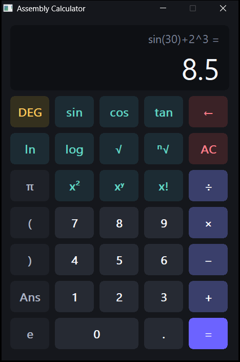

# Assembly-Calculator

A scientific calculator written **entirely in x86-64 assembly** — the maths engine, the expression parser, the number formatter *and* the native Windows GUI. There is no C, no C runtime and no `libm`: the executable is about 12 KB and talks directly to `user32` / `gdi32` / `kernel32`.

<p align="center"></p>

## Features

| Category | What you get |
|---|---|
| Arithmetic | `+` `−` `×` `÷`, parentheses, unary minus, implicit multiplication (`2π`, `3(4+1)`, `2sin(30)`) |
| Powers & roots | `xʸ`, `x²`, `√` (square root), `ⁿ√` (any n-th root, so `3√27 = 3`, and odd roots of negatives work: `3√-8 = -2`) |
| Logarithms | `log` (base 10), `ln` (natural) |
| Trigonometry | `sin` `cos` `tan`, with a **DEG / RAD** toggle |
| Other | factorial `x!` (0–170), constants `π` and `e`, `Ans` (previous result) |
| Comfort | live preview of the result while you type, keep calculating from the last answer (press `+` after `=`), friendly `Error` state you can edit your way out of |

### Using it

* **Mouse:** click the buttons.
* **Keyboard:** digits and `+ - * / ^ ( ) ! .` work as typed; `Enter` or `=` evaluates; `Backspace` deletes (a function such as `sin(` is removed as one unit); `Esc` clears.
  Letter shortcuts: `s` sin · `c` cos · `t` tan · `l` log · `n` ln · `r` √ · `R` ⁿ√ · `p` π · `e` e · `a` Ans · `d` DEG/RAD.
* **nth root:** type the degree first, then `ⁿ√`, then the radicand: `3 ⁿ√ 27`.

## Build & run

Requirements: Windows 10/11 x64 and `gcc` from MinGW-w64 / MSYS2 (UCRT64) on `PATH`. gcc is only used as a driver for the GNU assembler and linker.

```powershell
.\build.ps1          # produces build\calculator.exe
.\build.ps1 -Test    # also runs the engine tests (needs Python 3)
.\build\calculator.exe
```

The underlying command is simply:

```
gcc src/gui.s src/engine.s -o build/calculator.exe -nostdlib -mwindows -Wl,-e,Start -Wl,--gc-sections -luser32 -lgdi32 -lkernel32 -ldwmapi -s
```

## Project layout

```
src/engine.s        parser, maths kernels, number formatting   (no OS calls at all)
src/gui.s           Win32 window, painting, input, state machine
tests/shim.s        exposes the engine through a plain C ABI for testing
tests/test_engine.py  builds the engine as a DLL and checks it with ctypes
build.ps1           build script
```

## How it works

**Parser.** A recursive-descent parser evaluates the expression buffer directly into an `xmm0` double — no AST, no allocation. Each button inserts a single-byte token (`S` = sin, `Q` = √ …) so the parser never compares strings. Precedence, lowest to highest: `+ −` → `× ÷` / implicit multiply → unary minus → `^` and `ⁿ√` (right-associative) → `!`. As in standard notation, `-2^2 = -4` and `2^3^2 = 512`.

**Maths.** Add/sub/mul/div/sqrt use SSE2. Transcendentals use the x87 unit at full 64-bit precision and round once on the way out:

* `log` / `ln` → `fyl2x` with `log10 2` / `ln 2` as the multiplier
* `xʸ` → exact binary exponentiation for integer `y`, otherwise `2^(y·log₂x)` with `fyl2x`, `f2xm1`, `fscale`
* `sin` / `cos` / `tan` → in degrees the angle is reduced by whole quadrants *exactly* before `fsincos`, so `sin 180° = 0`, `cos 90° = 0` and `tan 90°` is reported as undefined instead of returning rounding noise
* `n!` → x87 product loop, rounded once (170! is the largest value a double can hold)
* number literals are accumulated as an exact 64-bit mantissa and divided by an exact power of ten once, so `0.1` is the correctly rounded double

**Formatting.** Results are printed with up to 15 significant digits and trailing zeros removed (`0.1 + 0.2` shows `0.3`). The decimal exponent is found with `fyl2x` then corrected against `10^e` computed by binary exponentiation; digit extraction uses multiply-by-reciprocal instead of `div`. Very large or small values switch to `d.ddde+XX`.

**GUI.** One window class, **no child controls**. Everything is drawn by hand into a cached off-screen bitmap and blitted per *dirty rectangle*, so hovering a button repaints only that button. Hit-testing is two integer divisions plus a lookup table. All metrics and fonts scale with the system DPI, and the title bar follows the dark theme through `DwmSetWindowAttribute`.

### Optimisation notes

* Zero heap allocation, no CRT start-up, no imports beyond the window/GDI calls (≈12 KB binary).
* API calls go straight through the import-address table (`call [__imp_X]`), skipping the linker thunk.
* One parser pass per keystroke; state lives in fixed `.bss` buffers.
* Partial repaints, a persistent back buffer, and `WM_ERASEBKGND` suppressed (no flicker).
* Constants and tables are read-only and 16-byte aligned for the SSE masks.

## Testing

`tests/test_engine.py` assembles the engine into a DLL and drives it from Python:

* 77 hand-written cases: precedence, associativity, implicit multiplication, every operation, DEG and RAD trig identities, domain errors (`1/0`, `√-1`, `log 0`, `171!`, `tan 90°`, unbalanced brackets), formatting edge cases;
* 3000 random inputs × 10 operations (30,000 checks) compared against Python's `math` module to a relative error of 1e-13.

## Limitations

* Windows x64 only (it is a Win32 program written in assembly).
* Numbers are IEEE doubles (about 15–16 significant digits), so display is capped at 15.
* Factorial accepts non-negative integers up to 170.
* Input of numbers in exponent form (`1e5`) is not supported; use `10^5`.
